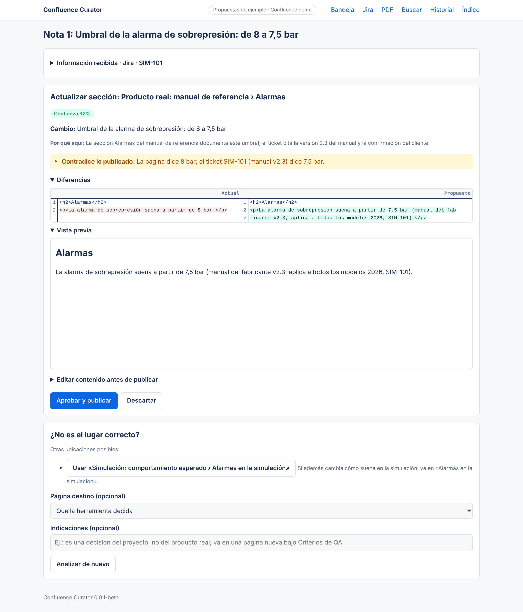
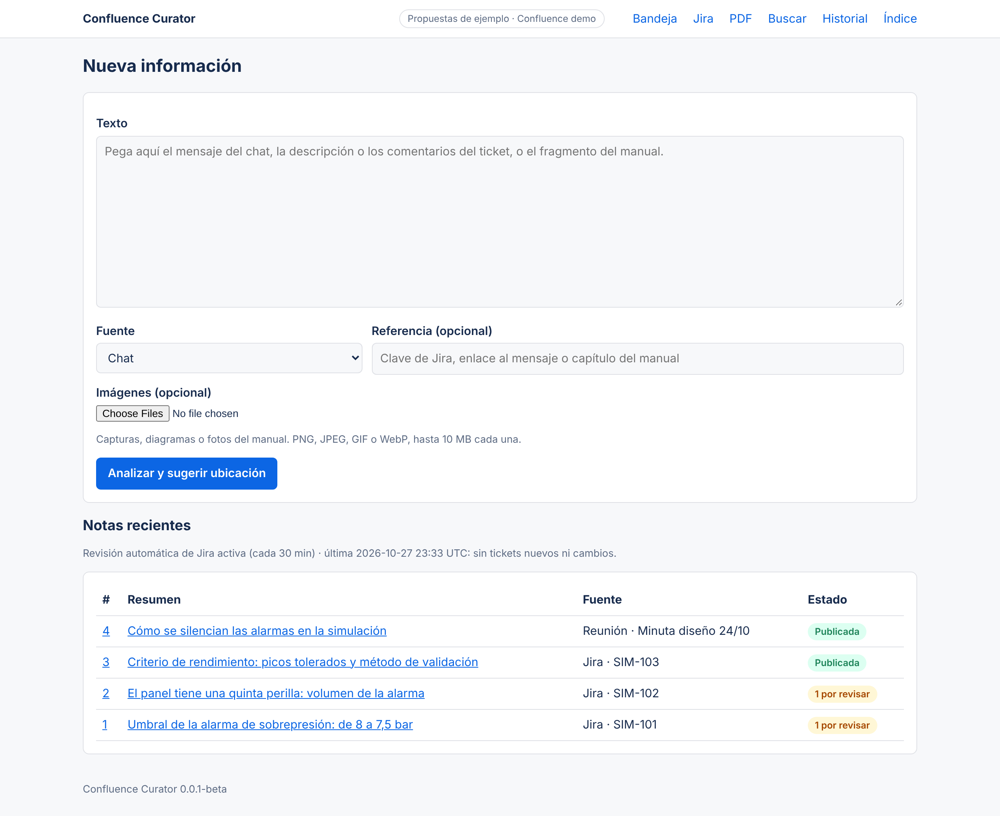
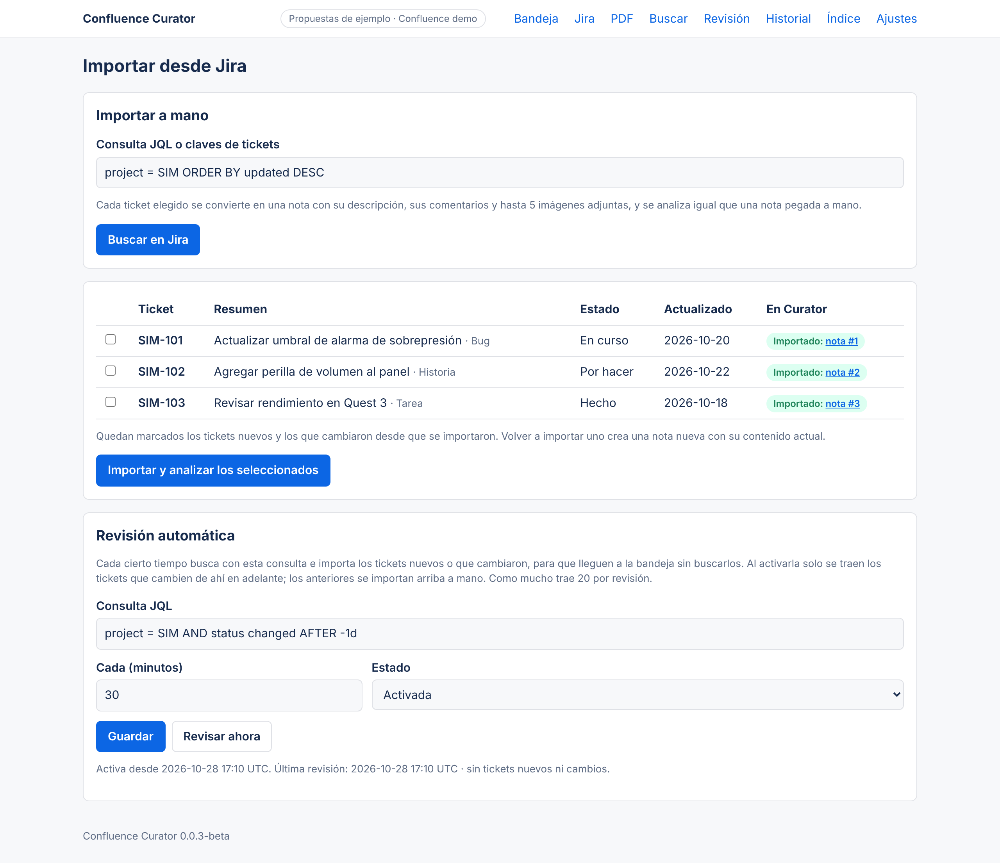
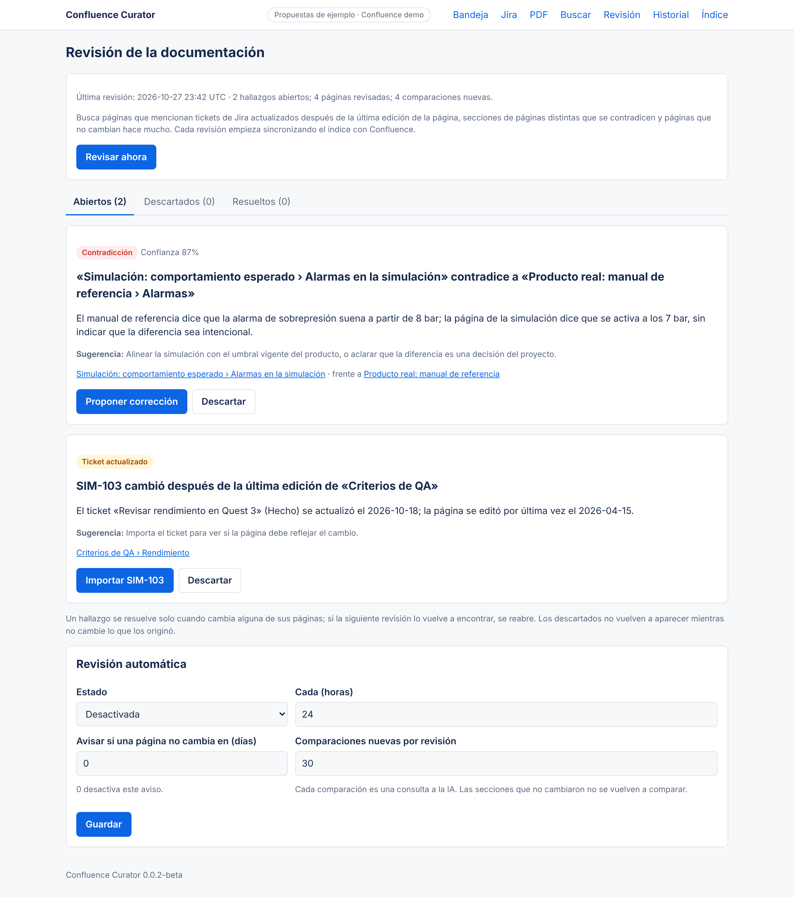
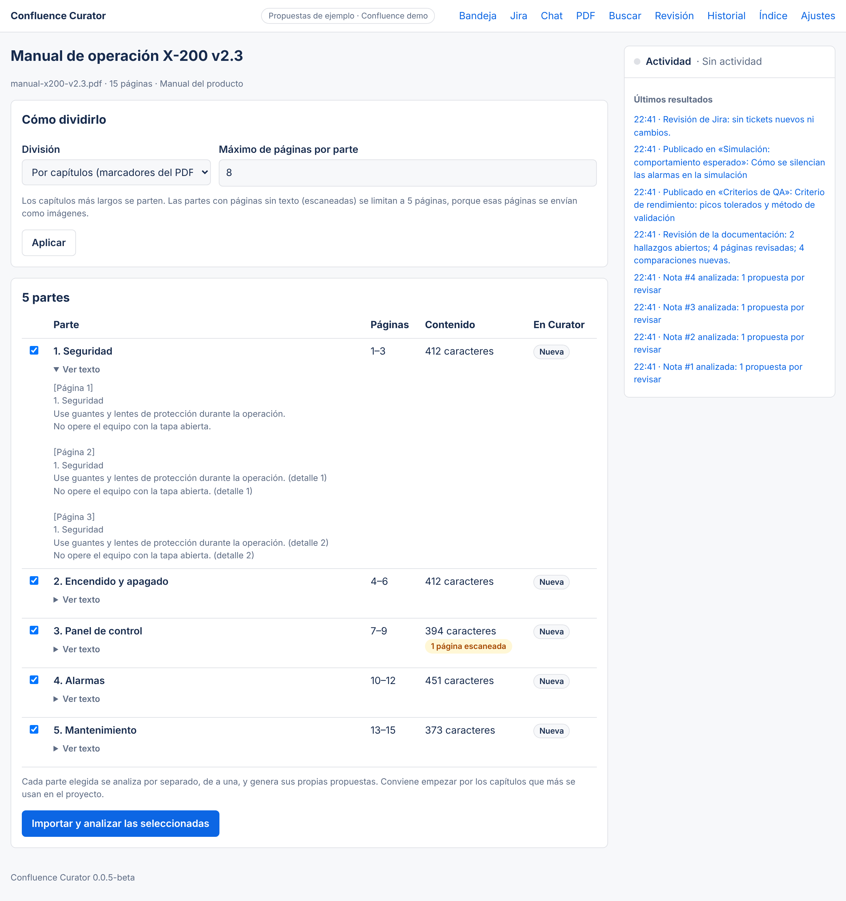
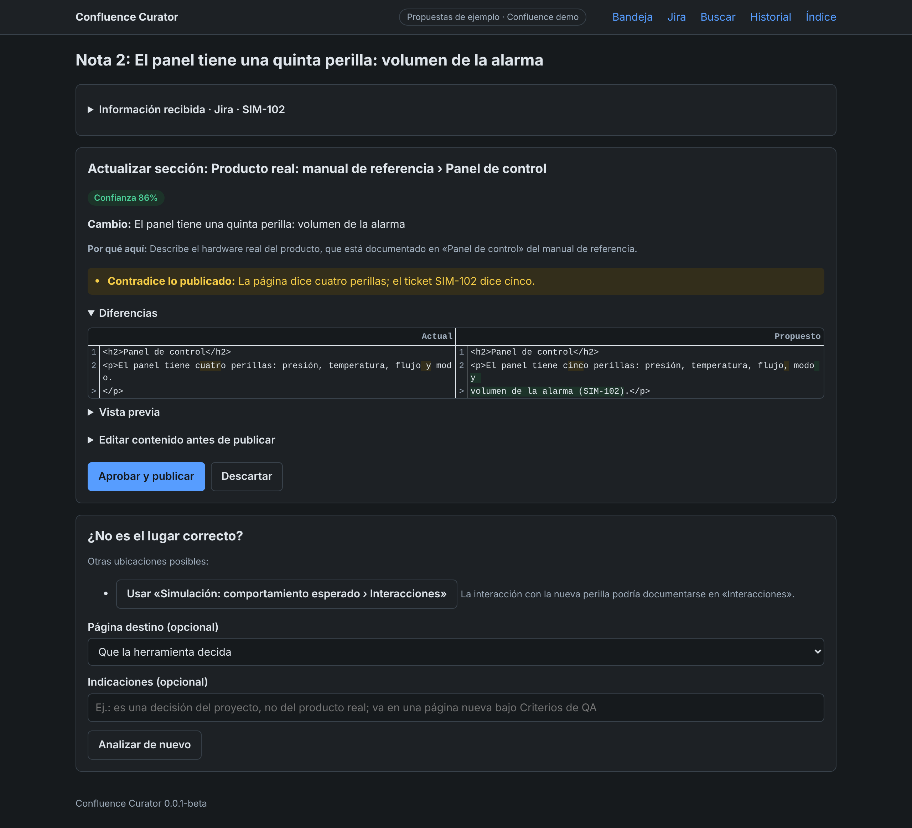
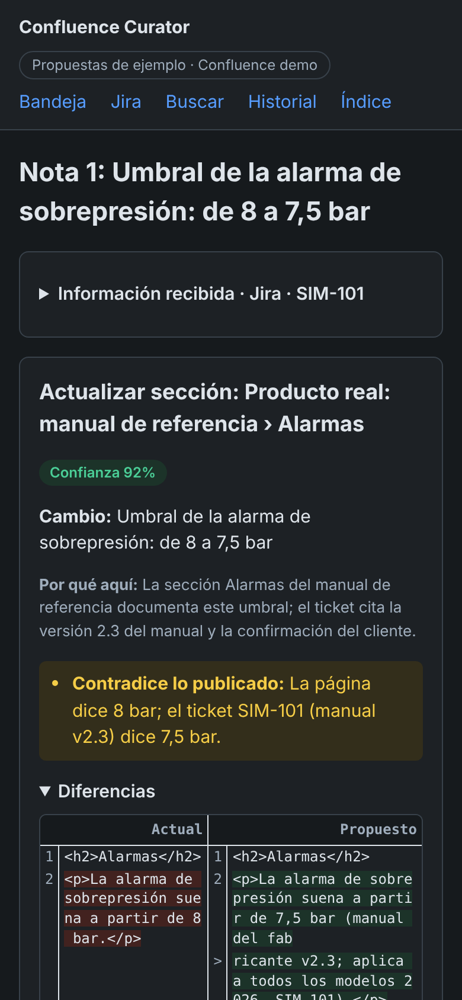
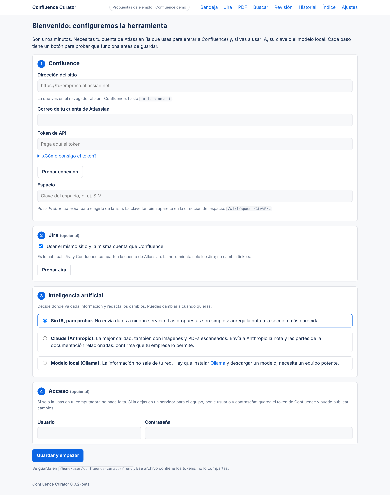

# Confluence Curator

> **Beta 0.0.3.** La conexión con Confluence Cloud y Jira Cloud reales ya se probó; el resto del flujo (propuestas y publicación) se probó con un Confluence simulado. Los lanzadores funcionan en Mac y Linux; el de Windows todavía no se probó. Haz las primeras publicaciones en páginas sin importancia.

Herramienta para consolidar en Confluence la información del proyecto que hoy está dispersa en chats, tickets de Jira y manuales del producto.

Le das un texto o una imagen, la traes directamente de tickets de Jira o subes un PDF (por ejemplo, el manual del producto), y la herramienta:

1. Busca en el espacio de Confluence las secciones relacionadas.
2. Propone dónde va: actualizar una sección, agregar al final de una página o crear una página nueva. Muestra el porqué, una confianza y las contradicciones con lo ya publicado (por ejemplo, "antes 8 bar, ahora 7,5 bar").
3. Te muestra las diferencias y una vista previa. Puedes editar el contenido, elegir otra ubicación o descartarlo.
4. **Solo publica cuando lo apruebas.** Antes de publicar vuelve a leer la página en vivo; si alguien cambió esa sección mientras tanto, se detiene y te pide volver a analizar. Las imágenes se suben como adjuntos de la página.

Cada publicación queda en el historial de versiones de Confluence, con el resumen del cambio y el número de nota, y en la página *Historial* de la herramienta.

## Capturas

Tomadas en el modo demo, con Confluence y Jira simulados y propuestas de ejemplo escritas a mano (no generadas por un modelo).

**Propuesta para un ticket de Jira:** dónde va, por qué, la contradicción con lo publicado, las diferencias y la vista previa.



**Bandeja:** notas pegadas a mano o traídas de Jira, con su estado.



**Jira:** importación a mano y revisión automática con una consulta guardada.



**Revisión:** una contradicción entre dos páginas y una página que menciona un ticket que cambió después.



**PDF:** un manual dividido por capítulos, con la página escaneada detectada.



<details>
<summary>Modo oscuro y móvil</summary>





</details>

## Cómo decide dónde va la información

Hay tres modos, que se eligen con `CURATOR_ADVISOR`:

- **IA local (`ollama`):** un modelo que corre en tu equipo o en un servidor de tu red con [Ollama](https://ollama.com). Hace el mismo trabajo que con Claude (lee la nota, la compara con las secciones de Confluence, señala contradicciones y redacta el cambio), y **la información no sale de tu red**. Ver [IA local con Ollama](#ia-local-con-ollama).
- **Con IA en la nube (`anthropic`, Claude):** lee la nota, las imágenes, el árbol de páginas del espacio y las secciones más parecidas, y redacta el cambio respetando el estilo de la página. Distingue entre lo que hace el producto real y lo que decide el proyecto para la simulación, y si no queda claro lo indica.
- **Sin IA (`mock`, modo de prueba):** agrega la nota tal cual a la sección con más palabras en común. Sirve para probar el flujo sin enviar información a ningún servicio externo.

Si `CURATOR_ADVISOR` está vacío, se usa Claude cuando hay `ANTHROPIC_API_KEY` y, si no, el modo sin IA. **Antes de activar Claude, confirma que la política de tu empresa permite enviar a la API de Anthropic la información del proyecto y el contenido del espacio.** Con la IA activada se envían, en cada análisis, la nota, sus imágenes, los títulos de las páginas y el contenido de las secciones candidatas.

## Instalación paso a paso

No hace falta saber programar ni usar la terminal.

1. **Instala Python** (gratis), versión 3.11 o superior, desde <https://www.python.org/downloads/>. En Windows, durante la instalación, **marca la casilla «Add python.exe to PATH»**. En Mac, abre el instalador descargado y sigue los pasos. Si ya lo tienes, sáltate este paso: el lanzador avisa si falta.
2. **Descarga la herramienta**: en la página [Releases](https://github.com/cesared19/confluence-curator/releases) elige la versión más reciente y descarga *Source code (zip)*. Descomprímelo en una carpeta fija, por ejemplo *Documentos*.
3. **Ábrela con doble clic** en el lanzador de tu sistema, dentro de esa carpeta:
   - **Windows:** `iniciar-windows.bat`. Si aparece «Windows protegió su PC», pulsa *Más información* y *Ejecutar de todas formas*.
   - **Mac:** `iniciar-mac.command`. La primera vez, haz clic derecho, elige *Abrir* y confirma (macOS lo pide con archivos descargados de internet).
   - **Linux:** `iniciar-linux.sh` (o `./iniciar-linux.sh` en una terminal).

   Se abre una ventana negra: la primera vez instala lo necesario (uno o dos minutos) y después abre el navegador.
4. **Sigue el asistente** que aparece en el navegador: dirección de Confluence, correo y token de Atlassian (con el enlace para crearlo), espacio, Jira, IA y, si quieres, una contraseña. Cada paso tiene un botón para probar que funciona. Al guardar, la herramienta lee el espacio y queda lista.

Para usarla otro día, vuelve a abrir el lanzador. Mientras la usas, deja abierta la ventana negra; para cerrarla, cierra esa ventana. Si abres el lanzador cuando ya está en marcha, solo se abre el navegador. La configuración se puede cambiar cuando quieras en **Ajustes**.

Para actualizar a una versión nueva, descárgala en otra carpeta y copia desde la anterior el archivo `.env` (la configuración) y la carpeta `data` (notas e historial).



### Instalación manual

Para quien prefiere la terminal (Python 3.11 o superior):

```bash
python -m venv .venv && source .venv/bin/activate
pip install -r requirements.txt
python -m curator --open   # http://127.0.0.1:8000; la primera vez abre el asistente
```

En lugar del asistente se puede copiar `.env.example` a `.env` y completarlo a mano.

Para probar sin credenciales, usa un Confluence simulado con páginas de ejemplo:

```bash
CURATOR_DEMO=1 python -m curator
```

El modo demo incluye también tres tickets de Jira de ejemplo.

Con Docker: `docker compose up -d --build` y abre <http://127.0.0.1:8000>, que muestra el asistente. La configuración y los datos quedan en el volumen `curator-data` (`/data/config.env` y `/data/curator.db`) y la interfaz se publica solo en `127.0.0.1:8000`.

### IA local con Ollama

1. Instala Ollama (<https://ollama.com/download>) en tu equipo o en un servidor de la red.
2. Descarga un modelo: `ollama pull gemma3:12b`.
3. En **Ajustes**, paso 3, elige *Modelo local (Ollama)*, pulsa *Probar Ollama* y elige el modelo de la lista. (A mano: `CURATOR_ADVISOR=ollama` y, si hace falta, `OLLAMA_URL`, `OLLAMA_MODEL` y `OLLAMA_CONTEXT` en `.env`.)

Sobre el modelo:

- Para analizar imágenes necesita visión (`gemma3`, `qwen2.5vl`, `llama3.2-vision`). Si eliges uno sin visión, usa notas solo de texto.
- La calidad depende del tamaño del modelo. Con modelos de 4 a 8 mil millones de parámetros la ubicación suele ser razonable, pero la redacción y la detección de contradicciones son más flojas. `gemma3:12b` (unos 8 GB, con GPU de 12 GB o una Mac con 16 GB) es un buen punto de partida; `gemma3:27b` o `qwen2.5vl:32b` rinden mejor si el equipo lo permite. Sin GPU funciona, pero cada análisis puede tardar varios minutos.
- `OLLAMA_CONTEXT` (32768 por defecto) es cuánto texto lee el modelo de una vez: la nota más las secciones candidatas. Si una página es muy larga, súbelo o baja `CURATOR_CANDIDATES` (10 por defecto).
- Con Docker, si Ollama corre en el mismo equipo, usa `OLLAMA_URL=http://host.docker.internal:11434`.

### Credenciales de Confluence

El asistente las pide y las prueba. Si prefieres el archivo `.env`:

- `CONFLUENCE_BASE_URL`: `https://tu-empresa.atlassian.net`.
- `CONFLUENCE_EMAIL` y `CONFLUENCE_API_TOKEN`: una cuenta con permiso de ver, editar y adjuntar en el espacio. El token se crea en <https://id.atlassian.com/manage-profile/security/api-tokens>. Las ediciones aparecen a nombre de esa cuenta.
- `CONFLUENCE_SPACE_KEY`: la clave del espacio (está en la URL, `/wiki/spaces/CLAVE/...`).

Si la herramienta corre en un servidor compartido, ponle usuario y contraseña (paso 4 del asistente, o `CURATOR_USER` y `CURATOR_PASSWORD`). Por seguridad, **Ajustes** solo se abre desde la computadora donde corre la herramienta, salvo que tenga contraseña.

### Jira

Si Jira está en el mismo sitio de Atlassian que Confluence, no hace falta configurar nada: usa la misma URL, el mismo correo y el mismo token. La cuenta necesita permiso para ver los proyectos de Jira que quieras importar. Si Jira está en otro sitio o quieres otra cuenta, define `JIRA_BASE_URL`, `JIRA_EMAIL` y `JIRA_API_TOKEN`. `JIRA_MAX_IMAGES` (5 por defecto) limita cuántas imágenes adjuntas se traen por ticket.

La herramienta solo lee Jira: no cambia tickets ni agrega comentarios.

## Uso diario

- **Bandeja:** pega el texto (un hilo de chat, la descripción y los comentarios de un ticket, un fragmento del manual), indica la fuente y adjunta imágenes si hacen falta. Una nota puede generar varias propuestas si toca varios temas.
- **Jira:** busca con JQL (por ejemplo `project = SIM AND updated >= -14d ORDER BY updated DESC`) o escribiendo claves (`SIM-101, SIM-102`). Elige los tickets y cada uno se convierte en una nota con sus datos (tipo, estado, etiquetas, versiones, responsables), la descripción, todos los comentarios, el enlace y las imágenes adjuntas (hasta 10 MB cada una). Las notas se analizan en segundo plano, de a una; la bandeja muestra *Analizando…* y se actualiza sola. La lista indica qué tickets ya se importaron y cuáles cambiaron desde entonces, que quedan marcados para volver a importarlos.
- **Revisión automática de Jira:** en la página Jira guarda una consulta JQL y cada cuántos minutos revisarla (mínimo 5). La herramienta importa sola los tickets nuevos o que cambiaron, hasta 20 por revisión; los demás quedan para la siguiente. Al activarla solo trae lo que cambie de ahí en adelante, para no llenar la bandeja con tickets viejos; esos se importan a mano. *Revisar ahora* la ejecuta en el momento. La bandeja muestra cuándo fue la última revisión y si falló. La revisión corre mientras la aplicación esté encendida.
- **PDF:** sube un manual, una especificación o un documento de diseño (hasta 50 MB). La herramienta lo divide por capítulos usando los marcadores del PDF o, si no tiene, en bloques de páginas; los capítulos largos se parten (8 páginas por parte por defecto, ajustable). Puedes ver el texto de cada parte, elegir cuáles importar y cada una se convierte en una nota que se analiza en cola, citando el documento y las páginas. Al extraer el texto se quitan los encabezados y pies que se repiten y se unen las palabras cortadas con guion. Las páginas sin texto (escaneadas o solo con dibujos) se envían como imágenes, hasta 5 por parte (`PDF_MAX_SCANNED_PAGES`); para leerlas hace falta Claude o un modelo local con visión. La lista indica qué partes ya se importaron.
- **Revisión de la documentación:** la página *Revisión* busca tres cosas en el espacio:
  - **Tickets actualizados:** páginas que mencionan un ticket de Jira (por ejemplo `SIM-103`) que cambió después de la última edición de la página. Con *Importar* el ticket se convierte en una nota.
  - **Contradicciones:** secciones parecidas de páginas distintas que afirman cosas incompatibles (por ejemplo, 8 bar en el manual y 7 bar en la simulación). Las compara la IA, que también indica cuál parece desactualizada; no cuenta como contradicción una diferencia que el texto presenta como decisión del proyecto. *Proponer corrección* crea una nota dirigida a esa sección, que sigue el flujo normal de propuesta y aprobación. Sin IA esta parte no se hace.
  - **Páginas sin cambios:** las que no se editan hace más de 180 días (ajustable; 0 lo desactiva).

  Se ejecuta con *Revisar ahora* o sola cada N horas (24 por defecto), empezando por sincronizar el índice. Un hallazgo se resuelve solo cuando cambia alguna de sus páginas y se reabre si la siguiente revisión lo vuelve a encontrar; los descartados no vuelven mientras no cambie lo que los originó. Cada comparación es una consulta a la IA: por revisión se hacen como mucho 30 nuevas (ajustable) y las secciones que no cambiaron no se vuelven a comparar, así que las primeras revisiones de un espacio grande avanzan por partes. Solo se comparan las secciones más parecidas entre sí, no todas contra todas, así que puede escaparse alguna contradicción.
- **Revisar:** en cada propuesta revisa las diferencias y la vista previa. *Editar contenido* permite corregir el XHTML antes de publicar; `[[IMAGEN:n]]` coloca la imagen n de la nota.
- **¿No es el lugar correcto?** Elige una alternativa sugerida, una página destino o escribe una indicación ("es una decisión del proyecto, no del producto") y vuelve a analizar.
- **Buscar:** consulta rápida de qué dice hoy la documentación sobre un tema.
- **Índice:** sincroniza cuando se edite Confluence por fuera de la herramienta.

Consejo para la consolidación inicial: empieza por la información de mayor autoridad (manuales del producto, decisiones cerradas) y deja para después los hilos de chat. Así la herramienta tiene una base contra la cual detectar contradicciones.

## Desarrollo

```bash
pip install -r requirements-dev.txt
python -m pytest
```

Para regenerar las capturas de `docs/screenshots` (requiere Node y Playwright):

```bash
python scripts/demo_server.py --port 8770 &
node scripts/screenshots.mjs http://127.0.0.1:8770
```

Estructura:

- `curator/confluence.py`: cliente de Confluence Cloud (API v2; v1 para adjuntos).
- `curator/jira.py`: cliente de Jira Cloud (API v3) y conversión de descripciones y comentarios (formato ADF) a texto.
- `curator/audit.py`: revisión de la documentación (tickets actualizados, contradicciones y páginas sin cambios).
- `curator/pdf.py`: lectura de PDFs, capítulos por marcadores, limpieza del texto y conversión a imagen de las páginas sin texto.
- `curator/storage.py`: divide las páginas en secciones por encabezados sobre el texto original, de modo que al reemplazar una sección el resto de la página no cambia. También valida el XHTML.
- `curator/search.py`: búsqueda BM25 sin acentos (español e inglés).
- `curator/advisor.py`: asesores (Claude y Ollama con salida estructurada, y modo sin IA).
- `curator/service.py`: flujo de notas, propuestas y publicación, importación de Jira y cola de análisis en segundo plano.
- `curator/web.py` y `curator/templates/`: interfaz web (FastAPI + Jinja).
- `curator/setup.py`: asistente de configuración (pruebas de conexión y guardado en `.env`).
- `iniciar-windows.bat`, `iniciar-mac.command`, `iniciar-linux.sh` y `scripts/iniciar.sh`: lanzadores de doble clic.
- `curator/demo.py`: Confluence y Jira simulados.
- `scripts/`: servidor de demostración con propuestas de ejemplo y script de capturas.

## Limitaciones conocidas

- Trabaja con un solo espacio a la vez.
- Las secciones se definen por encabezados (`h1` a `h6`). En páginas sin encabezados, la página entera es una sola sección.
- No lee directamente Slack ni Teams: los mensajes del chat se pegan a mano.
- Volver a importar un ticket trae el ticket completo otra vez, no solo lo nuevo. Con la IA activada no suele duplicar nada, porque compara con lo ya publicado, pero el análisis tarda más.
- De Jira solo trae imágenes adjuntas; los demás archivos (PDF, videos, logs) quedan fuera. Un PDF adjunto a un ticket se puede descargar y subir en la página PDF.
- De los PDFs con texto no se extraen las figuras: los diagramas de una página con texto no llegan al análisis. Si una figura importa, súbela como imagen en una nota.
- Las tablas de los PDFs llegan como texto plano, sin columnas.

## Próximos pasos posibles

- Importar desde el chat que usa el equipo.
